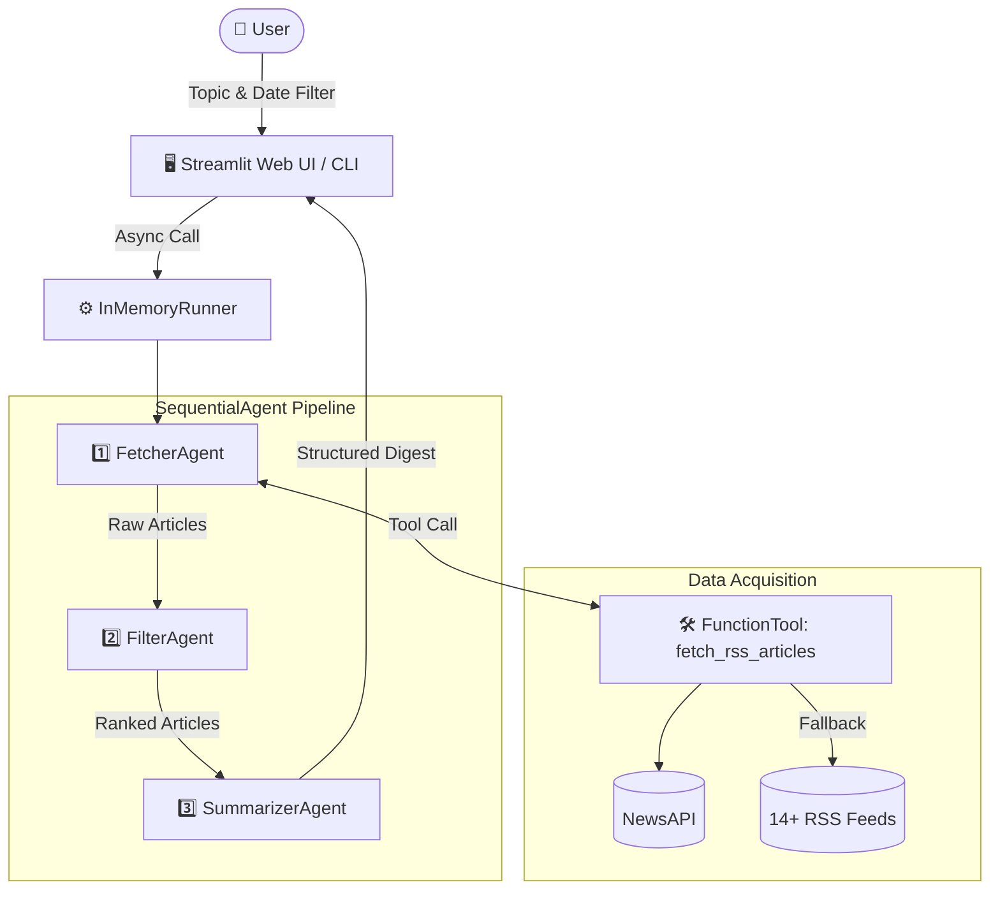

# 🗞️ NewsAI Agent

[](https://www.python.org/)
[](https://github.com/google/adk)
[](https://ai.google.dev/)
[](https://streamlit.io/)
[](LICENSE)

An intelligent, multi-agent news aggregator and summarizer built with **Google ADK (Agent Development Kit)**, **Google Gemini 2.5 Flash Lite**, and **Streamlit**. 

NewsAI autonomously retrieves stories across global and regional sources, filters for relevance, and generates structured executive digests tailored to any topic and timeframe.

---

## 🌟 Key Features

- **Sequential Multi-Agent Pipeline**: Powered by Google ADK's `SequentialAgent` and `InMemoryRunner`, orchestrating three specialized agents:
  1. **FetcherAgent**: Queries NewsAPI or scrapes curated RSS feeds.
  2. **FilterAgent**: Discards low-relevance stories and deduplicates headlines.
  3. **SummarizerAgent**: Synthesizes key developments into crisp bullet points with direct source citations.
- **Dual Retrieval with Resilient Fallback**:
  - Direct topic search via **NewsAPI**.
  - Automatic, seamless fallback to **14+ RSS feeds** if the API key is not configured or rate limits are reached.
- **Global & Multilingual Regional Coverage**:
  - **International**: BBC News, Reuters, CNN, Al Jazeera
  - **Tech**: TechCrunch, The Verge, Hacker News
  - **India (English)**: NDTV, The Hindu, Times of India
  - **India (Hindi & Marathi)**: NDTV India, Zee News Hindi, ABP Majha, Loksatta
- **Production-Grade Resilience**: Built-in exponential backoff retries (`types.HttpRetryOptions`) for HTTP 429, 500, 503, and 504 status codes.
- **Modern Dark-Themed Web UI**: Fast, responsive Streamlit dashboard with preset topics, date range filtering, and clean markdown cards.

---

## 🏗️ Architecture



---

## 📁 Repository Structure

```text
NewsAgent/
├── app.py                  # Streamlit web application & UI
├── requirements.txt        # Python package dependencies
├── .env.example            # Environment variables template
├── .gitignore              # Git ignore rules for Python, venv & secrets
├── LICENSE                 # MIT License
├── README.md               # Project documentation
└── news_agent/             # Core multi-agent package
    ├── __init__.py         # Package initialization
    ├── agent.py            # SequentialAgent pipeline & Gemini setup
    └── rss_tool.py         # NewsAPI client, RSS scraper & fallbacks
```

---

## 🚀 Quick Start

### 1. Prerequisites

- Python 3.10 or higher
- A Google Gemini API key ([Get a free key here](https://aistudio.google.com/app/apikey))
- *(Optional)* NewsAPI key ([Get a free key here](https://newsapi.org/register))

### 2. Clone the Repository

```bash
git clone https://github.com/<your-username>/NewsAgent.git
cd NewsAgent
```

### 3. Create a Virtual Environment

```bash
python3 -m venv .venv
source .venv/bin/activate    # On Windows: .venv\Scripts\activate
```

### 4. Install Dependencies

```bash
pip install -r requirements.txt
```

### 5. Configure Environment Variables

Copy `.env.example` to `.env`:

```bash
cp .env.example .env
```

Open `.env` and insert your credentials:

```ini
GOOGLE_API_KEY=your_gemini_api_key_here
NEWSAPI_KEY=your_newsapi_key_here  # Optional
```

---

## 💻 Running the Application

### Launch Streamlit Dashboard

```bash
streamlit run app.py
```

Then open your browser at `http://localhost:8501`.

### Programmatic Python Usage

You can also run the agent pipeline programmatically in scripts or notebooks:

```python
import asyncio
from news_agent.agent import run_news_agent

async def main():
    digest = await run_news_agent(
        topic="Artificial Intelligence",
        date_filter="today"  # Options: "today", "yesterday", "last_3_days", "all"
    )
    print(digest)

if __name__ == "__main__":
    asyncio.run(main())
```

---

## ⚙️ Configuration Reference

| Environment Variable | Required | Description |
| :--- | :--- | :--- |
| `GOOGLE_API_KEY` | **Yes** | Authentication key for Google Gemini model calls via Google ADK. |
| `NEWSAPI_KEY` | No | Enables server-side keyword searching via NewsAPI. If not provided, direct RSS keyword fallback is used. |

---

## 📄 License

This project is licensed under the MIT License - see the [LICENSE](LICENSE) file for details.
